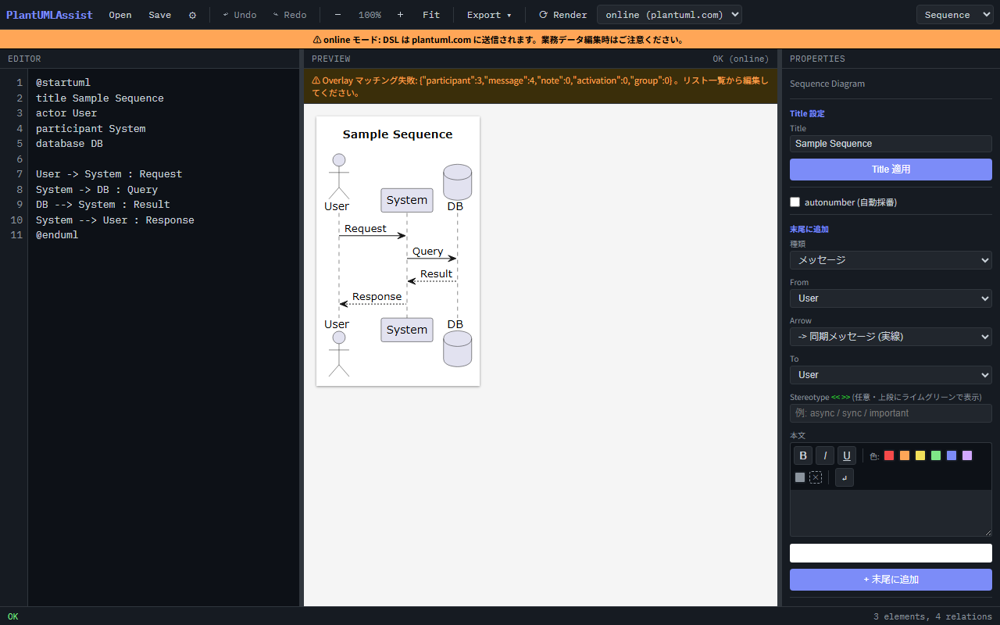

# PlantUMLAssist

PlantUML 記法の本文(`.puml`)を正本に、GUI で UML 図を直すローカルのツール。Python の `server.py` + 単一 HTML `plantuml-assist.html` + `src/`(ビルド無し)。



6 図種(シーケンス / ユースケース / コンポーネント / クラス / アクティビティ / 状態遷移)。図の要素を押す・右パネルのフォームで足すと、押した要素の行だけを最小の差分で本文に書き戻す。
描画は PC の中の `lib/plantuml.jar` で行い、図を外へ送らない。手書きや他の道具で作った既存の `.puml` を壊さず開いて直せる。

機能の全部は製品仕様書 [`docs/spec/product-spec.md`](docs/spec/product-spec.md)(場面ごとに、できること・入口・振る舞い・確かめる spec)。

## できること

### 開く

Import ▾(ファイルを開く・クリップボードから開く・🕘 最近開いた図)、ドラッグ&ドロップ、FILES ツリー。タブで複数の図を開き、左端の図種レールで新しい図の図種を選ぶ。日本語名・別名つきの宣言や旧記法の図もそのまま開く。

### 直す(6 図種で共通の操作)

図の要素にマウスを乗せると枠が出て、押すと右パネルで直せる。右パネルの「末尾に追加」と「まとめて」で足し、図の行間の ＋ で途中に差し込む。本文と図の相互ジャンプ、↑↓ で選び続ける、Ctrl+Z / Ctrl+Y、位置を保ったズーム、図の設定(図名・タイトル・外観)、Ctrl+K コマンドパレット、ツール ▾(行を書き換える・部品名を一括置換する・複数クラスに一括適用する)、⚙ 設定。

### 直す(図種ごとの操作)

シーケンス図の矢印の種類・向き・通し番号・alt / loop の範囲・注釈の位置、状態遷移図の子状態・擬似状態・状態遷移表、クラス図の属性と関係、アクティビティ図の分岐パターン、コンポーネント図の関係のカード・ステレオタイプ・境界、ユースケース図の 2 つ選んで関係を追加。

### 描く

打つたび・操作のたびに `lib/plantuml.jar` で描き直す(`POST /render`。仕様は `GET /render` が JSON で返す)。描けないときも直前の図を残し、読めない行を知らせる。`!include` した共通ファイルも描く。

### 保存する

Ctrl+S と自動保存で、保存先から開いた図はそのファイルに書く。直していない図はバイト単位で一致したまま。保存先に書くのは `.puml` と押した書き出しだけ。前の版は FILES の右クリック「この図の履歴」で見比べ・戻せる。

### 書き出す

上部バー Export ▾ で今の図を SVG / PNG / PNG(透過背景)/ クリップボードに書き出す(Ctrl+E)。

### フォルダで図を扱う

FILES ツリーで保存先を選び、図を開く・絞る・名前変更・複製・移動・削除する。保存フォルダの一覧、隣のフォルダを書かずに開く「読むだけ」節、Git の変更を見る GIT 節。

### 図をまたいで名前を替える

ツール ▾ → 部品名を一括置換する(Ctrl+H)で、開いている図と保存先の図をまたいで部品名を替える。当てる図を先に数えて選べ、過去の置換の組を押すと両欄が埋まる。

### 配布と確かめる入口

Windows 単体アプリ(portable zip / インストーラ。`start.bat`・`PlantUMLAssist.exe`)、⚙ 設定 → 情報「更新を確認」、確かめる入口 `scripts\build.ps1` / `test.ps1` / `verify.ps1`。

## セットアップ

> **初回のみ**: リポジトリには PlantUML jar を同梱していません (ライセンス整合性のため)。
> 下記いずれかで `lib/plantuml.jar` を配置してください。

```bash
# macOS / Linux / WSL / Git Bash
bash lib/fetch-plantuml.sh

# Windows PowerShell
.\lib\fetch-plantuml.ps1
```

または PlantUML 公式リリース (https://github.com/plantuml/plantuml/releases) から任意のライセンス変種 (GPLv3 / LGPL / Apache 2.0 / EPL / MIT / BSD) を手動ダウンロードして `lib/plantuml.jar` として配置してください。詳細は `lib/README.md` を参照。

## 起動

> HTML をダブルクリックしても動きません。Python バックエンド経由でアクセスしてください。

```bash
python server.py
```

コンソールに `PlantUMLAssist server starting on http://127.0.0.1:8766` と表示されたら、ブラウザで **http://127.0.0.1:8766/** を開きます。

Windows では `start.bat` をダブルクリックでも起動可能 (server.py を起動してブラウザを自動で開きます)。

**自動停止**: ブラウザタブを閉じるとサーバーも自動で停止します (heartbeat 方式、タブ close 後 2〜6秒以内に終了)。F5 リロードは自動判定で継続。明示的に止めたい場合は `Ctrl+C`。

### Windows アプリ版 (exe / インストーラ)

Python も Java も PlantUML も入っていない相手に配る形です。画面は Web 版と同じ
`plantuml-assist.html` / `src/` を読むので、機能に差はありません。

```bash
python -m pip install pywebview      # 開発機で試すとき
python app.py                        # 窓で開く (Web 版は python server.py のまま)
```

配布物は GitHub Actions (`.github/workflows/windows-app.yml`) が `v*` タグで作ります。
リポジトリにバイナリは入れません。手元で作るなら:

```bash
python -m pip install pywebview pyinstaller
pyinstaller packaging/PlantUMLAssist.spec --noconfirm
iscc packaging\installer.iss           # Inno Setup 6 が要ります
```

- **plantuml.jar は同梱しません**。初回起動後、⚙設定 → レンダリング →
  「jar を選ぶ」でファイルを指定するか、「公式から取得」を押してください。
  選んだ場所は `.assist-prefs.json` (アプリ版では `%APPDATA%\PlantUMLAssist\`) に残ります。
- **Java も同梱しません**。同じ画面に検出結果が出ます。無ければ
  [Temurin](https://adoptium.net/temurin/releases/) を入れてください (Java 11 以上)。
- アプリ版の保存・書き出しはネイティブのファイルダイアログです
  (Web 版はブラウザのダウンロード)。

## 要件

- Python 3 (標準ライブラリのみ、追加パッケージ不要)
- **Java 11 以降 推奨** (常駐 JVM daemon モードで高速化)
  - Java 8〜10 でも動作可能だが、自動的に毎回 JVM 起動する従来モード (低速) にフォールバック
  - online モードのみ使うなら Java 不要
- `lib/plantuml.jar` (**別途ダウンロード必要**、fetch スクリプト提供。推奨版は下の「推奨 PlantUML 版」、約 30 MB)
- `lib/PlantUMLDaemon.java` (リポジトリ同梱、ビルド不要 — Java 11+ の single-file source-launcher が直接実行)

Java がインストールされていない場合は、⚙ 設定の描画エンジンを `online (plantuml.com)` に切替えて使用可能。plantuml.com の公開サーバを利用するため、**業務データは外部送信される** ことに注意。

### 推奨 PlantUML 版

**推奨 PlantUML 版: 1.2026.8**(開発・自動検証はこの版で行う。これより古い版は並行領域が描かれない等の既知の差がある)。

- 推奨版は `lib/PLANTUML_VERSION` の 1 行だけに書く。`lib/fetch-plantuml.ps1` / `.sh`、設定 → レンダリング の「公式から取得」、
  設定欄の版の表示はここを読む
- 設定 → レンダリング に「使用中: 1.2026.3 / 推奨: 1.2026.8」のように使っている版と推奨版が並び、違えば隣の「取得し直す」で推奨版に替えられる。
  版は jar のマニフェストから読む (通信しない)
- 1.2026.3〜1.2026.6 は並行領域 (`--` / `||`) を持つ複合状態で最初の領域しか描かない (残りの領域が黙って消える)。
  これらの版を使っていると、設定欄にその旨が 1 行出る
- Windows アプリのインストーラは jar を同梱しない (初回に「公式から取得」で推奨版を取る)

### Java バージョン別の挙動

| バージョン | 動作 | 初回 render | 2回目以降 |
|---|---|---|---|
| **Java 11+** (推奨) | 常駐 daemon モード。JVM を1回だけ起動して stdin/stdout pipe 通信 | ~400ms (JVM warmup) | **~10-30ms** |
| Java 8 / 9 / 10 | 従来モード (自動フォールバック)。毎回 `java -jar plantuml.jar -pipe` を起動 | ~1.5s | ~1.5s |
| Java 未インストール | local モード使用不可。online モードは使用可 | — | — |

daemon モードでは **ネットワークソケットを一切開きません** (pipe 通信のみ)。外部から daemon プロセスにアクセスすることは OS レベルで不可能です。

### トラブルシューティング

| 症状 | 原因 | 対策 |
|---|---|---|
| "Render error: Failed to fetch" | server.py が起動していない / HTML を `file://` で開いている | `python server.py` を起動し、`http://127.0.0.1:8766/` にアクセス |
| "java not found" (local mode) | Java 未インストール | JDK/JRE 11+ をインストール (Java 8-10 でも動作するが低速)、または online モードへ切替 |
| local mode で毎回数秒かかる | Java 10 以下で daemon モードが起動できず従来モードにフォールバック | Java 11 以降 (LTS: 11 / 17 / 21) にアップグレード推奨 |
| "online render failed: HTTP 4xx/5xx" | plantuml.com のレート制限/障害 | 時間をおいて再試行、または local モードへ切替 |

## テスト

Windows PowerShell から `powershell -NoProfile -ExecutionPolicy Bypass -File scripts\<名前>.ps1` で呼ぶ。どれも exit 0 が緑。

| 入口 | すること |
|---|---|
| `scripts\build.ps1 [-Force]` | `node_modules` が無いときだけ `npm ci`。Java と python が PATH にあること、`lib\plantuml.jar` があることを確かめる (git worktree で jar が無ければ本体のチェックアウトの `lib\` から写す。ダウンロードはしない) |
| `scripts\test.ps1` | unit (`node tests/run-tests.js`) |
| `scripts\verify.ps1 -Scenarios <dir\|files> -Out <絶対パス>` | Playwright で台本の scenario (`tests/scenarios/{persona}-{手順}-{場面}.spec.js`) を回し、`<Out>\summary.json` に scenario ごとの passed / failed・操作から描画までの ms (`renderMs`)・1 操作で動いた本文の行数 (`diffLines`) を書く。フォルダを渡すと既存の e2e のうち `tests/e2e/scenarios` も回す (`-NoE2E` で外す。`tests/e2e/legacy` は `-E2EProject legacy\|all` のときだけ)。scenario のファイルだけ渡すとその scenario だけ、`tests/e2e/` の spec を渡すとその e2e だけ |

試験のサーバは worker ごとに `PUA_DATA_ROOT` (`test-results\e2e-data\`) 付きで起こすので、利用者の本物の保存先と設定には触れない。ポートは `PUA_PORT` から空きを探す。

## 設計ドキュメント

- **製品仕様書**: `docs/spec/product-spec.md`(残した機能の全部)/ 整理表 `docs/spec/feature-triage.md`
- **最初の設計**: `docs/superpowers/specs/2026-04-17-plantuml-assist-design.md`
- **Tier1 master spec**: `docs/superpowers/specs/2026-04-24-plantuml-tier1-complete-master.md`
- **Overlay-driven**: `docs/superpowers/specs/2026-04-26-tier1-overlay-driven-design.md`
- **直接操作 UX チェックリスト**: `docs/direct-manipulation-ux-checklist.md`
- 用語: `CONTEXT.md`。ADR: `docs/adr/` (ADR-101+)。ECN: `docs/ecn/`

## ライセンス

本リポジトリは **MIT** (`LICENSE` 参照)。

`lib/plantuml.jar` は同梱していません。利用者が PlantUML 公式から任意のライセンス変種 (GPLv3 / LGPL / Apache 2.0 / EPL / MIT / BSD) をダウンロードして配置します。jar のライセンスはその配布元の条項に従い、本リポジトリのライセンスとは別扱いです。
